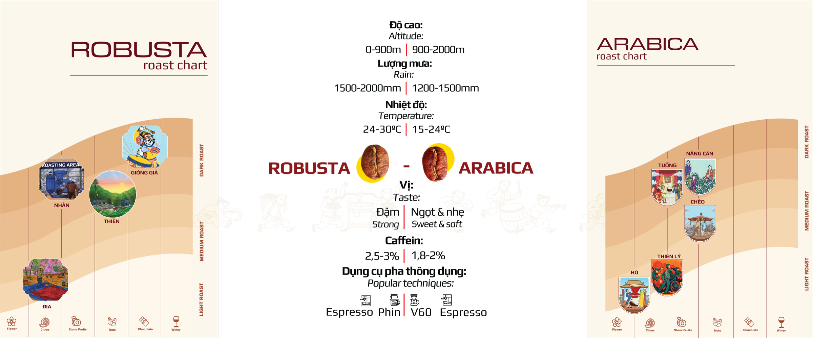

Robusta và Arabica là hai dòng cà phê được trồng phổ biến nhất. Bảng dưới đây so sánh nhanh hai dòng này.

| | Robusta | Arabica |
| --- | --- | --- |
| Độ cao | 0 – 900m | 900 – 2000m |
| Lượng mưa | 1500 – 2000mm | 1200 – 1500mm |
| Nhiệt độ | 24 – 30°C | 15 – 24°C |
| Vị | Đậm | Ngọt và nhẹ |
| Caffeine | 2,5 – 3% | 1,8 – 2% |
| Dụng cụ pha thông dụng | Espresso, phin | V60, Espresso |

